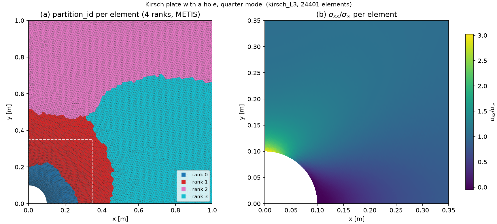
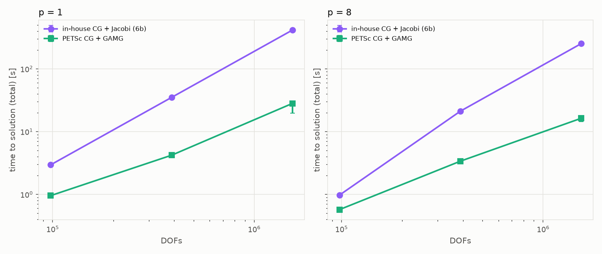
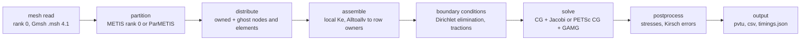

# mpi-cst-fem-solver

[](https://github.com/FreddyJuka/mpi-cst-fem-solver/actions/workflows/ci.yml)
[](LICENSE)

A parallel 2D linear-elastic finite element solver in C++ with MPI domain decomposition and Constant Strain Triangle (CST) elements, verified against the Kirsch solution and benchmarked on one node.



*Quarter model of a plate with a circular hole (`kirsch_L3`, 4 ranks). (a) METIS partition per element; (b) `sigma_xx / sigma_inf` per element, zoomed on the hole (stress concentration factor close to 3). Produced by `python/plot_fields.py`.*

## Overview

- 2D small-strain linear elasticity, plane stress or plane strain, CST elements, Gmsh `.msh` 4.1 input.
- MPI domain decomposition: METIS partitioning on rank 0 (optional ParMETIS, on all ranks), row-owner distributed CSR matrix, distributed assembly and Dirichlet elimination, halo exchange.
- In-house distributed CG with Jacobi preconditioner; optional PETSc backend (CG + GAMG with the rigid-body near-null space).
- Verification against the analytical Kirsch solution (stress concentration at a circular hole) with mesh-convergence rates.
- Python tooling (Gmsh API): mesh generation and checking, convergence study, scaling benchmarks and figures.
- Output: ParaView `.pvtu` (one piece per rank), CSV sections along the hole and the symmetry line, `timings.json`.

## Key results

All numbers below are copied from the linked documents; see them for the setup, tables and caveats.

- **Convergence rates match the theory** (plane stress, levels 2-5): displacement L2 1.989 (expected 2), energy norm 0.995 (expected 1), centroid stress L2 0.987 (expected 1). SCF 3.0055 at level 5 against 3 theoretical. Jacobi-CG iterations grow as DOFs^0.516 (expected 0.5). [docs/VERIFICATION.md](docs/VERIFICATION.md)
- **Serial and parallel runs agree** within the solver tolerance: end-to-end tests compare the serial path and the distributed path on 1, 2 and 4 ranks (relative maximum difference below 1e-8, `tests/CMakeLists.txt`); patch tests pass to machine precision in serial and in parallel. [docs/SPEC.md](docs/SPEC.md), section 13
- **PETSc cross-check:** on `kirsch_L1` (rtol 1e-12) the in-house CG + Jacobi and PETSc CG + Jacobi both take 295 iterations at 1, 2 and 4 ranks and agree to 3-4e-15 (relative). [docs/BENCHMARKS.md](docs/BENCHMARKS.md)
- **GAMG vs Jacobi, iterations:** CG + GAMG needs 22-26 iterations from 50k to 2.0 M DOFs (fitted power 0.02), CG + Jacobi 2,168 to 9,122 (power 0.51). [docs/BENCHMARKS.md](docs/BENCHMARKS.md#gamg-vs-jacobi-time-to-solution)
- **GAMG vs Jacobi, time to solution** (single node, p = 1 to 10): total time 1.7-3.1 times faster on L4, 6.1-8.3 on L5 and 14.7-17.2 on L6; solve-only 3.4-5.1, 14.1-18.1 and 27.4-43.1 times. The L6 p = 1 GAMG time is bimodal (about 20 s or 28 s); the 14.7 uses the median, and 20.7 the fast mode (both reported). [docs/BENCHMARKS.md](docs/BENCHMARKS.md)
- **Single-node scaling has two regimes.** L4 (97,760 DOFs) is cache-resident and reaches S = 4.33 at p = 10. L5, L6 and the weak-scaling series are limited by the shared memory bandwidth of the node: their SpMV runs at the STREAM triad level and the speedup saturates at 1.66-1.75 (about 4 ranks saturate the memory system). **Multi-node behavior was not tested**: one laptop, one node, shared-memory MPI only, so inter-node communication and per-node bandwidth scaling are unmeasured, and the single-node saturation is not a prediction for a cluster. [docs/BENCHMARKS.md](docs/BENCHMARKS.md)
- **With GAMG the bottleneck moves to the serial rank-0 phases** (read + partition): 9.0 % of the L6 total at p = 1 and 39.8 % at p = 8. [docs/BENCHMARKS.md](docs/BENCHMARKS.md)





## Architecture



**Data layout.** Rank 0 reads the mesh and partitions the elements; every node is owned by the lowest rank among the partitions that use it, and nodes are renumbered so that the owned DOFs of a rank form a contiguous range of the global numbering. The matrix is a **row-owner distributed CSR**: each rank stores the rows of its owned DOFs, split into a local block `A_loc` (owned columns) and a ghost block `A_ghost` (columns owned elsewhere). Two ghost sets exist and are different:

- **Element ghosts**: non-owned nodes referenced by the rank's own elements. They are used to assemble (contributions to rows owned elsewhere are sent to the owner once with `MPI_Alltoallv` and summed), to apply loads, and to evaluate stresses.
- **SpMV halo**: the non-owned columns of the owned rows. `y = A x` starts the halo exchange, computes `A_loc x`, waits, then adds `A_ghost x_halo`, overlapping communication with computation.

Details: [docs/SPEC.md](docs/SPEC.md), sections 4-6.

## Build

Requirements: CMake >= 3.20, a C++17 compiler, MPI (OpenMPI or MPICH), METIS (`libmetis-dev`), Python >= 3.10 for the tooling.

```
cmake -S . -B build
cmake --build build -j
```

Optional backends (both OFF by default):

```
cmake -S . -B build -DUSE_PARMETIS=ON   # ParMETIS parallel partitioner
cmake -S . -B build -DUSE_PETSC=ON      # PETSc solver backend (via pkg-config)
```

PETSc is found with pkg-config (module `PETSc`); besides the default search path, CMake also looks in `PETSC_DIR[/PETSC_ARCH]/lib/pkgconfig` (CMake or environment variable) and in the Debian/Ubuntu prefix `/usr/lib/petscdir/petsc-real`. Configuration fails unless PETSc is a real double-precision build (`PetscScalar = double`) whose `PetscInt` holds our `int` indices (32-bit PETSc indices match; 64-bit ones are a safe widening). On Ubuntu 24.04: `sudo apt-get install petsc-dev pkgconf` (PETSc 3.19.6). CI builds without PETSc and ParMETIS. A custom METIS location can be given with `-DMETIS_ROOT=/path`.

**Tests.**

```
ctest --test-dir build --output-on-failure
```

On OpenMPI with fewer physical cores than ranks, configure with `-DCSTFEM_MPI_OVERSUBSCRIBE=ON`. Builds with `-DUSE_PETSC=ON` also register `test_petsc_np{1,2,4}` (PETSc vs in-house solver, GAMG with and without the near-null space, patch tests, Kirsch error metrics) and an end-to-end `solver = petsc` run on 2 ranks compared with the serial output.

## Quick start

```
# 1. Mesh (Gmsh Python API); level n halves the element size n times
python3 -m venv python/.venv
python/.venv/bin/pip install -r python/requirements.txt
mkdir -p meshes
python/.venv/bin/python python/mesh_kirsch.py --level 2 -o meshes/kirsch_L2.msh
python/.venv/bin/python python/check_mesh.py meshes/kirsch_L2.msh   # independent mesh check

# 2. Solve (run from the repository root)
mpiexec -n 1 ./build/cstfem_solve cases/kirsch_L2.case   # serial code path
mpiexec -n 4 ./build/cstfem_solve cases/kirsch_L2.case   # distributed path, 4 ranks

# 3. Inspect: results/kirsch_L2/solution.pvtu opens in ParaView; independent decode and comparison
python/.venv/bin/python python/check_vtu.py results/kirsch_L2
```

Open `results/kirsch_L2/solution.pvtu` in ParaView and color by `sigma_xx`, `von_mises` or `partition_id` (cell data). Points carry `displacement`, `owned` (1 on the owning rank; filter `owned = 1` to remove the duplicates of shared nodes) and `gmsh_tag`.

Outputs in `output_dir`, for both paths: `solution.pvtu` with one `solution_<rank>.vtu` per rank (cell arrays: `sigma_xx`, `sigma_yy`, `tau_xy`, `von_mises`, `sigma_zz` (plane strain), `partition_id`, `element_id`, and for the Kirsch case the analytical stresses and errors); `hole_sigma_tt.csv` and `section_x0_sigma_xx.csv` (Kirsch case); `timings.json` (path, partitioner, ranks, DOFs, solver iterations and residuals, error metrics, per-phase times min/max/mean over ranks and the load report for the distributed path; with PETSc also `petsc_matrix`, `pc_setup`, `ksp_solve`). The true residual `||b - Ax|| / ||b||` is recomputed with the solver's own distributed operator for both backends.

`python/check_vtu.py <output_dir> [--compare <reference_dir>]` decodes the pieces independently (xml + base64 + numpy) and optionally compares displacements (by Gmsh tag), element arrays (by element id) and CSVs with another run. The partitioning step alone: `mpiexec -n 4 ./build/cstfem_solve cases/kirsch_L3.case --partition-only` writes `partition.pvtu`.

## Case file reference

A case file is a plain `key = value` text file (`#` starts a comment). Paths are relative to the working directory. Keys without a default are required. Unknown keys produce a warning.

| Key | Default | Meaning |
|---|---|---|
| `mesh` | required | Gmsh `.msh` 4.1 file. |
| `plane` | required | `plane_stress` or `plane_strain`. |
| `E` | required | Young's modulus, positive. |
| `nu` | required | Poisson's ratio, in (-1, 0.5). |
| `thickness` | required | Plate thickness. |
| `output_dir` | `results` | Output directory. |
| `path` | `auto` | `auto`: serial code for 1 rank, distributed otherwise; `serial`; `distributed` (also on 1 rank: the baseline for speedup studies). `serial` with more than 1 rank is an error. |
| `partitioner` | `metis` | `metis` (rank 0) or `parmetis` (needs `-DUSE_PARMETIS=ON`). |
| `solver` | `cg_jacobi` | In-house Jacobi-preconditioned CG, or `petsc` (needs `-DUSE_PETSC=ON`; always the distributed path). |
| `rtol` | `1e-10` | Relative tolerance of the CG residual. |
| `max_iter` | `20000` | Maximum CG iterations. |
| `instrument` | `true` | Per-rank solver time breakdown in `timings.json` (`solve_breakdown`, in-house solver only). The solution is identical either way. |
| `bc.dirichlet` | empty | `group:ux=0 ; group:uy=0 ...` on mesh physical groups. |
| `bc.traction` | empty | `kirsch_exact` (exact Kirsch traction on `right` and `top`) or `group:tx=..,ty=..`. |
| `kirsch.sigma_inf` | required with `kirsch_exact` | Far-field stress. |
| `kirsch.a` | required with `kirsch_exact` | Hole radius, positive. |
| `petsc.near_nullspace` | `true` | Attach the three rigid-body modes as the GAMG near-null space. |
| `petsc.options` | empty | PETSc options, unquoted (for example `-pc_type jacobi`), applied last through `KSPSetFromOptions`. |
| `petsc.log_view` | `false` | Write PETSc's `-log_view` summary to `<output_dir>/petsc_log_view.txt`. |

Example: `cases/kirsch_L2.case`. The `cases/scaling_*.case` files are the benchmark cases.

## Repository layout

```
CMakeLists.txt          build configuration (version 1.0.0)
include/cstfem/         headers
src/                    mesh reader, partition, distributed assembly, solvers, PETSc backend, I/O, drivers
tests/                  unit tests, MPI tests, end-to-end checks (CTest); tests/data: small meshes
benchmarks/             stream_triad (memory bandwidth), clock_check (clock consistency)
python/                 mesh generation and checking, run_convergence, run_scaling, plotting, check_vtu, check_links
cases/                  example and benchmark case files
docs/                   specification, verification, benchmarks, raw results (json), figures
.github/workflows/      CI (Ubuntu 24.04, default build and ctest)
```

## Documentation

- [docs/SPEC.md](docs/SPEC.md): technical specification (physics, partitioning, data layout, solvers, testing).
- [docs/VERIFICATION.md](docs/VERIFICATION.md): Kirsch verification and convergence study.
- [docs/BENCHMARKS.md](docs/BENCHMARKS.md): strong and weak scaling, SpMV bandwidth, ParMETIS, PETSc GAMG, timing methodology, untested hypotheses.
- [docs/benchmark_gamg_phases.md](docs/benchmark_gamg_phases.md): phase times of every GAMG configuration.
- [docs/benchmark_l6_diagnosis.md](docs/benchmark_l6_diagnosis.md): raw measurements of the L6 bimodality diagnosis.
- Raw results: [verification_results.json](docs/verification_results.json), [benchmark_results.json](docs/benchmark_results.json), [benchmark_gamg_results.json](docs/benchmark_gamg_results.json).
- [CHANGELOG.md](CHANGELOG.md)

## Limitations and future work

- **Serial mesh input and partitioning.** Rank 0 reads the mesh and (with METIS) partitions it. With GAMG these phases are 9.0 % of the L6 total at p = 1 and 39.8 % at p = 8 and cannot shrink with p; parallel mesh input and partitioning are the next improvements for the total time. ParMETIS partitions faster but reading is separate.
- **Single-node benchmarks only.** All scaling results come from one laptop (WSL2, shared-memory MPI); multi-node behavior is untested. Some effects (for example the slowing read phase with p, the assembly plateau at p >= 4, and the bimodal L6 p = 1 time) have untested hypotheses listed in [docs/BENCHMARKS.md](docs/BENCHMARKS.md).
- **CST elements only:** 2D, linear triangles, small-strain isotropic linear elasticity. Higher-order elements, 3D, nonlinearity and dynamics are non-goals of v1.
- GAMG parallel speedup on one node is poor (memory-bandwidth bound iterations plus the serial phases above).

## Third-party dependencies

No third-party source code is vendored; dependencies are found on the system. The licenses below were read from the Debian/Ubuntu copyright files of the packages installed on the development machine (Ubuntu 24.04: `/usr/share/doc/<package>/copyright`); check them again for other versions.

| Dependency | Use | License (from the package copyright file) |
|---|---|---|
| OpenMPI 4.1.6 (`libopenmpi-dev`) | required (any MPI) | BSD-style 3-clause license text (redistribution with notice; no endorsement). Bundled components carry their own terms, e.g. ROMIO (University of Chicago permissive notice), ptmalloc2 (LGPL-2.1+), libltdl (LGPL-2+ with exception). |
| METIS 5.1.0 (`libmetis-dev`) | required | Apache-2.0. Some bundled GKlib files: BSD-3-clause (`ms_inttypes.h`, `ms_stdint.h`), LGPL-2.1+ (`getopt.c`, `gk_mksort.h`), BSD-like (`random.c`). |
| ParMETIS 4.0.3 (`libparmetis-dev`, Ubuntu multiverse) | optional (`-DUSE_PARMETIS=ON`) | The copyright file describes it as "non-free software" and states: "It can be freely used for educational and research purposes by non-profit institutions and US government agencies only. Other organizations are allowed to use ParMETIS/METIS only for evaluation purposes, and any further uses will require prior approval. The software may not be sold or redistributed without prior approval." |
| PETSc 3.19.6 (`petsc-dev` → `libpetsc-real3.19-dev`) | optional (`-DUSE_PETSC=ON`) | BSD-2-clause: "Copyright: (c) 1991-2014, UChicago Argonne, LLC and the PETSc Development Team"; redistribution in source and binary form with or without modification is permitted if the copyright notice, the conditions and the disclaimer are retained (and reproduced in documentation for binary forms); provided "as is" without warranty. The file notes that the license does not apply to packages obtained with PETSc's `--download-package` option, and lists a few files under other terms (STREAM benchmark license, Expat, MIT, BSD-3-clause). The Debian build of PETSc links further libraries with their own licenses (hypre, MUMPS, SuperLU, SuperLU_dist, PT-Scotch, ScaLAPACK, SuiteSparse, Trilinos ML, HDF5, FFTW, ...); these were not reviewed here. |

The default build (MPI + METIS) links the system libraries dynamically. METIS is Apache-2.0 with some bundled GKlib files under BSD-3-clause and LGPL-2.1+; OpenMPI's bundled components also include LGPL-licensed parts. This repository does not vendor or redistribute any of these libraries, so the repository code itself remains MIT.

**ParMETIS notice.** ParMETIS is strictly optional and off by default. This project never redistributes it: no vendored source, no release binaries, no container images that include it, and it is not used in CI. By installing ParMETIS and building with `-DUSE_PARMETIS=ON` you accept its license terms yourself; read `/usr/share/doc/libparmetis-dev/copyright` (or the license of the version you install) before doing so.

## Development note

**Development note.** This project was developed with AI assistance. The architecture, verification strategy and validation of all results were directed and reviewed by the author.

## License

MIT, © 2026 Freddy Juka. See [LICENSE](LICENSE).
