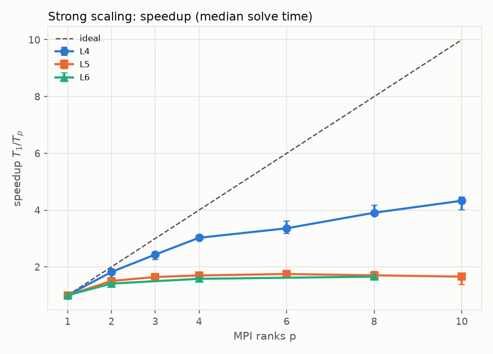
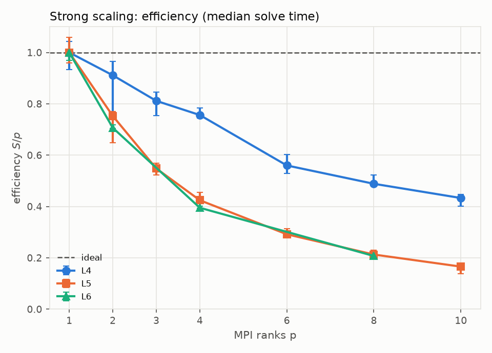
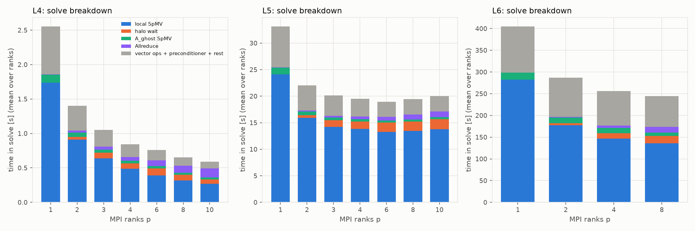
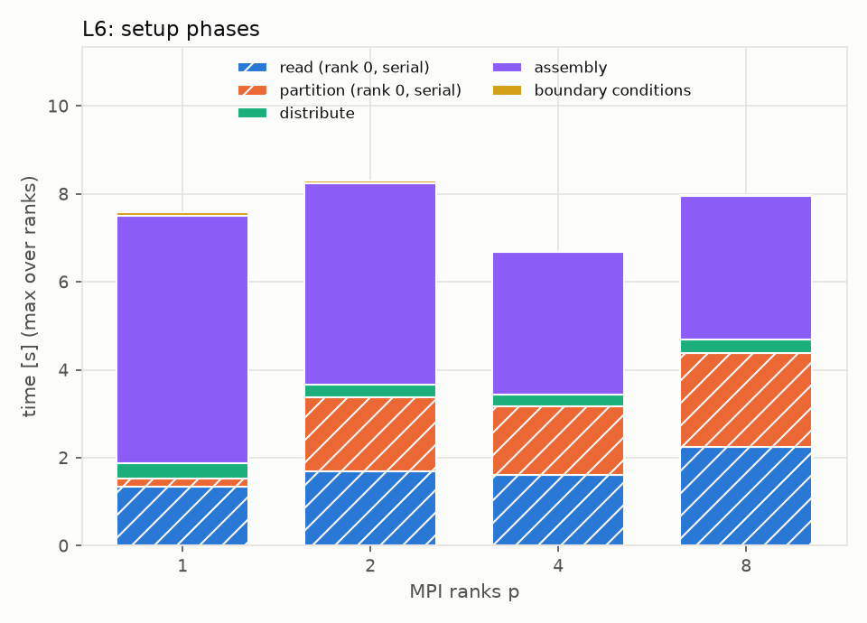
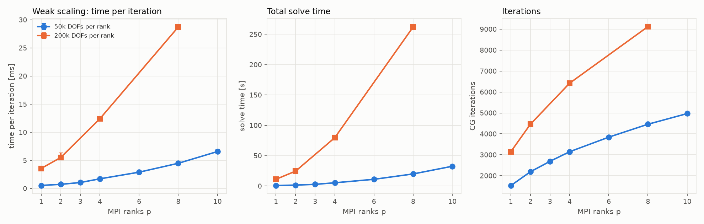
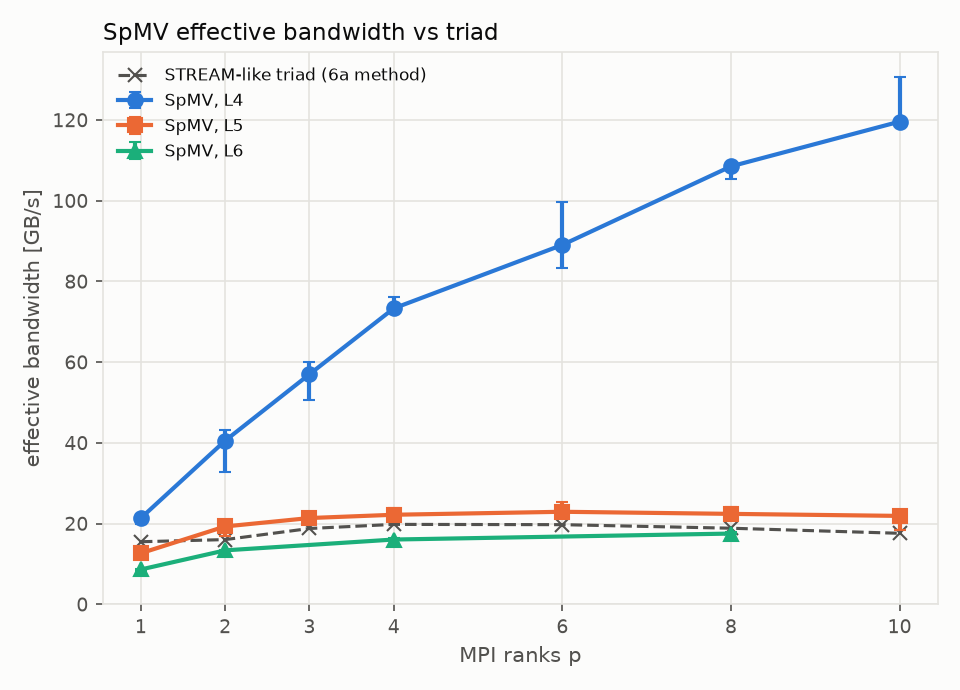

# Benchmarks: strong and weak scaling (Milestone 6b)

All numbers on this page come from `docs/benchmark_results.json`, produced by `python/run_scaling.py` and plotted by `python/plot_scaling.py`. Nothing here was tuned or edited by hand. The solver and C++ sources were not changed for this study.

## Hardware and its limitations

| | |
|---|---|
| CPU | Intel Core i7-12700H (laptop), as seen by the guest: 10 cores x 2 threads, one socket, one NUMA node |
| Caches (guest view) | L1d 480 KiB (10 instances), L2 12.5 MiB (10 instances), L3 24 MiB shared |
| Memory | 7.57 GiB, shared with Windows |
| OS / MPI / compiler | WSL2 (kernel 6.6.87.2), Open MPI 4.1.6, g++ 13.3.0, Release (`-O3 -DNDEBUG`) |
| Memory bandwidth (6a method) | STREAM-like triad, aggregate best: 15.5 GB/s at 1 rank, 19.8 GB/s at 4 ranks (peak), 17.6 GB/s at 10 ranks |

Limitations that matter when reading the results:

- **Laptop under WSL2.** The topology the guest sees (10 cores x 2 threads) is synthetic. The real i7-12700H has performance and efficiency cores with different speeds and cache sizes, and that layout is hidden from the guest. `--bind-to core` pins rank k to "core k", but we cannot tell which physical core type that is, so ranks may run at different speeds.
- **vCPU scheduling by Hyper-V.** The hypervisor schedules the vCPUs on the host and can move or delay them. Power and thermal limits of a laptop add frequency drift. This is why the repetitions are interleaved across np (below), and why some configurations are noisy (CV table below).
- **Memory bandwidth saturates early.** About 4 ranks already reach the triad peak (about 20 GB/s). Beyond that, extra ranks add no bandwidth, which bounds any bandwidth-bound kernel such as the SpMV.
- **Little memory.** 7.57 GiB total limits the largest meshes (about 2 M DOFs).
- **Hardware findings from 6a** (hidden P/E cores, synthetic topology, triad peak) were used as given; the triad curve was re-measured in this study with the same program (`build/benchmarks/stream_triad`, default size, best of 3 tries per np).

## Methodology

- Every run: `path = distributed` (also at np = 1), `partitioner = metis`, `instrument = true`, plane stress, `rtol = 1e-10`, Kirsch case as in `cases/kirsch_L*.case` (the case files are `cases/scaling_*.case`).
- Launch: `mpiexec --bind-to core --map-by core --report-bindings -n p build/cstfem_solve case`. The binding report of the first run of every (case, np) is stored in `docs/benchmark_results.json`; a sample (np = 4) is below. Every run reports rank k bound to core k, hardware threads 0-1.
- Per (mesh, np): one warm-up run, discarded, then the repetitions. Repetitions are the outer loop, np the inner loop, and the np order is rotated every repetition so that thermal drift does not favor one np.
- "Solve time" is the maximum over ranks of the solve phase. "Total time" is the maximum over ranks of the whole run. Median, min and max are over repetitions; **CV** is the sample standard deviation divided by the mean of the solve time. Configurations with CV > 5 % are marked with a warning sign.
- Speedup S = T1/Tp on the median, relative to np = 1 of the distributed path; efficiency E = S/p; Karp-Flatt e = (1/S - 1/p)/(1 - 1/p). Speedup error bars in the figures use T1(median) divided by the max and min of Tp.
- Weak scaling: two series with a target of 50,000 and 200,000 DOFs per rank, generated with `mesh_kirsch.py --target-dofs` (within 3 % of target). Time per iteration is the maximum over ranks of the solve total divided by the iteration count; weak efficiency is T_iter(1)/T_iter(p).
- **SpMV effective bandwidth** (approximate lower-bound traffic model). Bytes per SpMV = sum over ranks of `nnz*(8+4) + (rows+1)*4 + rows*8 (x) + rows*8 (y)`: matrix values (8 B) and column indices (4 B), row pointers, and the x and y vectors, with **x assumed read only once** (cache reuse of x is not credited beyond that, and ghost values are not counted). The bandwidth is that number times the iteration count divided by the time. **The time is the sum of the per-component maxima over ranks: max(local SpMV) + max(A_ghost SpMV).** The solver records only the maximum of each component, not the maximum of the per-rank sum, and the sum of maxima is at least the maximum of the sums. The reported bandwidth is therefore an approximate lower bound of the traffic rate. The triad curve counts 24 bytes per element (STREAM convention); with write-allocate the real traffic is 32 bytes, so the two numbers are comparable but not identical in definition.

### Repetitions: which configurations used 3 and which used 5

| configurations | np | warm-up + repetitions |
|---|---|---|
| strong L4, strong L5, weak 50k series, ParMETIS comparison (L5) | 1, 2, 3, 4, 6, 8, 10 (ParMETIS: 4, 8, 10) | 1 + **5** |
| strong **L6**, weak **200k** series | **1, 2, 4, 8** | 1 + **3** |

**Why.** A timed probe showed that one L6 run at np = 1 takes 394 s and one 200k-series run at p = 10 takes 425 s (2.0 M DOFs). The full plan (all np, 5 repetitions) was estimated at about 5.6 hours, above the 2.5 hour budget. The two most expensive groups were therefore reduced to np = 1, 2, 4, 8 and 3 repetitions, which brought the study to about 2.4 hours. Consequences: the 200k series ends at p = 8 (1.6 M DOFs, not 2.0 M); the L6 and 200k results have no np = 3, 6 or 10; and their min/max error bars come from 3 runs, so a median of 3 is less robust against a single outlier than a median of 5 (this matters for `weak_200k` at p = 2, CV 10.3 %).

Sample binding report (L4, np = 4):

```
rank 0 bound to socket 0[core 0[hwt 0-1]]: [BB/../../../../../../../../..]
rank 1 bound to socket 0[core 1[hwt 0-1]]: [../BB/../../../../../../../..]
rank 2 bound to socket 0[core 2[hwt 0-1]]: [../../BB/../../../../../../..]
rank 3 bound to socket 0[core 3[hwt 0-1]]: [../../../BB/../../../../../..]
```

## Meshes

| mesh | DOFs | DOFs per rank | file [MB] | generation [s] |
|---:|---:|---:|---:|---:|
| strong_L4 | 97,760 | – | 4.6 | n/a |
| strong_L5 | 389,072 | – | 19.5 | n/a |
| strong_L6 | 1,545,566 | – | 80.9 | 42.4 |
| weak_50k_p1 | 49,934 | 49,934 | 2.3 | 1.1 |
| weak_50k_p2 | 99,700 | 49,850 | 4.7 | 2.4 |
| weak_50k_p3 | 149,710 | 49,903 | 7.1 | 3.9 |
| weak_50k_p4 | 199,620 | 49,905 | 9.6 | 5.6 |
| weak_50k_p6 | 300,300 | 50,050 | 14.9 | 9.1 |
| weak_50k_p8 | 398,258 | 49,782 | 20.0 | 12.9 |
| weak_50k_p10 | 499,818 | 49,982 | 25.4 | 16.2 |
| weak_200k_p1 | 199,620 | 199,620 | 9.6 | 5.5 |
| weak_200k_p2 | 398,258 | 199,129 | 20.0 | 13.0 |
| weak_200k_p4 | 800,598 | 200,150 | 41.2 | 30.2 |
| weak_200k_p8 | 1,604,862 | 200,608 | 84.1 | 70.2 |

The strong-scaling meshes are the Kirsch quarter plate at refinement levels 4, 5 and 6 (CG needs 2,168 / 4,407 / 8,871 iterations). L4 and L5 were generated before this study, so their generation time was not recorded. The weak series reach 49,782-50,050 and 199,129-200,608 DOFs per rank.

## Strong scaling

Solve time, speedup and efficiency are on the median of the solve time; "total" includes read, partition, distribution, assembly, BCs, postprocessing and output.

### L4 (97,760 DOFs, 1 + 5 repetitions)

| p | solve median [s] | CV [%] | min–max [s] | S | E | Karp–Flatt e | total median [s] | S (total) | E (total) |
|---:|---:|---:|---:|---:|---:|---:|---:|---:|---:|
| 1 | 2.555 | 4.1 | 2.45–2.74 | 1.00 | 1.00 | – | 2.96 | 1.00 | 1.00 |
| 2 | 1.402 | 10.8 ⚠ | 1.32–1.72 | 1.82 | 0.91 | 0.097 | 1.76 | 1.68 | 0.84 |
| 3 | 1.049 | 4.3 | 1.01–1.13 | 2.43 | 0.81 | 0.116 | 1.39 | 2.12 | 0.71 |
| 4 | 0.845 | 2.0 | 0.816–0.858 | 3.03 | 0.76 | 0.107 | 1.17 | 2.52 | 0.63 |
| 6 | 0.761 | 5.5 ⚠ | 0.708–0.804 | 3.36 | 0.56 | 0.157 | 1.08 | 2.73 | 0.46 |
| 8 | 0.654 | 3.3 | 0.612–0.665 | 3.91 | 0.49 | 0.150 | 0.98 | 3.03 | 0.38 |
| 10 | 0.590 | 4.2 | 0.572–0.636 | 4.33 | 0.43 | 0.145 | 0.95 | 3.13 | 0.31 |

### L5 (389,072 DOFs, 1 + 5 repetitions)

| p | solve median [s] | CV [%] | min–max [s] | S | E | Karp–Flatt e | total median [s] | S (total) | E (total) |
|---:|---:|---:|---:|---:|---:|---:|---:|---:|---:|
| 1 | 33.2 | 3.9 | 31.3–34.6 | 1.00 | 1.00 | – | 35.10 | 1.00 | 1.00 |
| 2 | 22.0 | 7.2 ⚠ | 21.5–25.6 | 1.51 | 0.75 | 0.329 | 23.82 | 1.47 | 0.74 |
| 3 | 20.2 | 3.3 | 19.4–21.1 | 1.64 | 0.55 | 0.412 | 21.87 | 1.61 | 0.54 |
| 4 | 19.5 | 5.3 ⚠ | 18.2–21.1 | 1.70 | 0.42 | 0.452 | 21.10 | 1.66 | 0.42 |
| 6 | 18.9 | 3.7 | 17.6–19.2 | 1.75 | 0.29 | 0.485 | 20.60 | 1.70 | 0.28 |
| 8 | 19.5 | 4.3 | 18–19.6 | 1.70 | 0.21 | 0.528 | 21.22 | 1.65 | 0.21 |
| 10 | 20.0 | 10.0 ⚠ | 18.8–24 | 1.66 | 0.17 | 0.559 | 21.89 | 1.60 | 0.16 |

### L6 (1,545,566 DOFs, 1 + 3 repetitions, np = 1, 2, 4, 8)

| p | solve median [s] | CV [%] | min–max [s] | S | E | Karp–Flatt e | total median [s] | S (total) | E (total) |
|---:|---:|---:|---:|---:|---:|---:|---:|---:|---:|
| 1 | 405.1 | 2.0 | 403–418 | 1.00 | 1.00 | – | 414.2 | 1.00 | 1.00 |
| 2 | 286.7 | 1.0 | 282–288 | 1.41 | 0.71 | 0.415 | 295.8 | 1.40 | 0.70 |
| 4 | 256.3 | 0.9 | 253–257 | 1.58 | 0.40 | 0.510 | 263.5 | 1.57 | 0.39 |
| 8 | 244.4 | 1.2 | 242–248 | 1.66 | 0.21 | 0.547 | 252.7 | 1.64 | 0.20 |





### Solve breakdown

Shares of the solve time (mean over ranks of each component, median over repetitions). "dots + vector ops + other" holds the local dot products, the vector updates with the Jacobi preconditioner, the halo post, setup inside the solver and unaccounted time.



| mesh | p | local SpMV [%] | halo wait [%] | A_ghost [%] | Allreduce [%] | dots + vector ops + other [%] |
|---:|---:|---:|---:|---:|---:|---:|
| L4 | 1 | 68 | 0 | 5 | 0 | 27 |
| L4 | 2 | 65 | 3 | 4 | 2 | 26 |
| L4 | 3 | 61 | 8 | 4 | 4 | 23 |
| L4 | 4 | 58 | 10 | 5 | 6 | 21 |
| L4 | 6 | 51 | 14 | 4 | 11 | 19 |
| L4 | 8 | 48 | 13 | 5 | 15 | 18 |
| L4 | 10 | 45 | 11 | 5 | 22 | 18 |
| L5 | 1 | 73 | 0 | 4 | 0 | 23 |
| L5 | 2 | 72 | 2 | 3 | 1 | 22 |
| L5 | 3 | 71 | 6 | 3 | 1 | 19 |
| L5 | 4 | 71 | 7 | 2 | 2 | 17 |
| L5 | 6 | 70 | 9 | 2 | 4 | 15 |
| L5 | 8 | 69 | 9 | 2 | 5 | 14 |
| L5 | 10 | 69 | 10 | 2 | 5 | 14 |
| L6 | 1 | 70 | 0 | 4 | 0 | 26 |
| L6 | 2 | 62 | 2 | 5 | 1 | 31 |
| L6 | 4 | 57 | 5 | 5 | 2 | 31 |
| L6 | 8 | 55 | 7 | 3 | 5 | 29 |

### Setup phases (L6)

Max over ranks, median over repetitions, seconds. Read and partition run on rank 0 only (serial).

| p | read | partition | distribute | assembly | BCs | read + partition (rank 0) | total [s] |
|---:|---:|---:|---:|---:|---:|---:|---:|
| 1 | 1.33 | 0.20 | 0.33 | 5.64 | 0.08 | 1.54 | 414.2 |
| 2 | 1.69 | 1.69 | 0.28 | 4.59 | 0.05 | 3.38 | 295.8 |
| 4 | 1.60 | 1.56 | 0.28 | 3.24 | 0.03 | 3.16 | 263.5 |
| 8 | 2.25 | 2.14 | 0.30 | 3.26 | 0.02 | 4.39 | 252.7 |



## Weak scaling

### 50,000 DOFs per rank (1 + 5 repetitions)

| p | DOFs | DOFs per rank | iterations | time/iter [ms] | solve median [s] | CV [%] | min–max [s] | weak eff. |
|---:|---:|---:|---:|---:|---:|---:|---:|---:|
| 1 | 49,934 | 49,934 | 1530 | 0.53 | 0.82 | 2.8 | 0.775–0.833 | 1.00 |
| 2 | 99,700 | 49,850 | 2190 | 0.73 | 1.60 | 5.1 ⚠ | 1.45–1.65 | 0.73 |
| 3 | 149,710 | 49,903 | 2690 | 1.05 | 2.83 | 4.0 | 2.78–3.06 | 0.51 |
| 4 | 199,620 | 49,905 | 3147 | 1.71 | 5.39 | 3.6 | 5.03–5.51 | 0.31 |
| 6 | 300,300 | 50,050 | 3843 | 2.89 | 11.12 | 1.9 | 10.9–11.4 | 0.18 |
| 8 | 398,258 | 49,782 | 4460 | 4.47 | 19.96 | 2.0 | 19.4–20.5 | 0.12 |
| 10 | 499,818 | 49,982 | 4968 | 6.57 | 32.62 | 2.5 | 32–34.1 | 0.08 |

### 200,000 DOFs per rank (1 + 3 repetitions, p = 1, 2, 4, 8)

| p | DOFs | DOFs per rank | iterations | time/iter [ms] | solve median [s] | CV [%] | min–max [s] | weak eff. |
|---:|---:|---:|---:|---:|---:|---:|---:|---:|
| 1 | 199,620 | 199,620 | 3148 | 3.56 | 11.19 | 3.3 | 10.8–11.6 | 1.00 |
| 2 | 398,258 | 199,129 | 4462 | 5.51 | 24.58 | 10.3 ⚠ | 23.1–28.2 | 0.65 |
| 4 | 800,598 | 200,150 | 6419 | 12.41 | 79.64 | 0.3 | 79.3–79.8 | 0.29 |
| 8 | 1,604,862 | 200,608 | 9122 | 28.73 | 262.08 | 0.5 | 260–263 | 0.12 |



## SpMV effective bandwidth vs triad

Median, GB/s, with the approximate lower-bound traffic model above.

| p | triad [GB/s] | SpMV L4 | SpMV L5 | SpMV L6 |
|---:|---:|---:|---:|---:|
| 1 | 15.5 | 21.4 | 12.7 | 8.6 |
| 2 | 16.0 | 40.5 | 19.3 | 13.4 |
| 3 | 18.8 | 57.0 | 21.4 | – |
| 4 | 19.8 | 73.3 | 22.2 | 16.1 |
| 6 | 19.7 | 89.1 | 22.9 | – |
| 8 | 18.9 | 108.5 | 22.4 | 17.5 |
| 10 | 17.6 | 119.6 | 21.9 | – |



## ParMETIS vs METIS (L5, 1 + 5 repetitions)

Both partitioners were run with the same ParMETIS-enabled binary (`build-parmetis`, `-DUSE_PARMETIS=ON`) and interleaved in the same campaign, so they saw the same machine conditions. The "partition" column is the max over ranks of the partition phase (median); "owned rows max/mean" is the load imbalance.

| p | partitioner | partition [ms] | edge cut | owned rows max/mean | solve median [s] | CV [%] | iterations |
|---:|---:|---:|---:|---:|---:|---:|---:|
| 4 | METIS | 337 | 1015 | 1.0060 | 19.04 | 2.1 | 4407 |
| 4 | ParMETIS | 270 | 1081 | 1.0230 | 19.09 | 2.1 | 4408 |
| 8 | METIS | 549 | 1772 | 1.0080 | 20.24 | 2.7 | 4407 |
| 8 | ParMETIS | 249 | 1913 | 1.0371 | 19.89 | 2.3 | 4407 |
| 10 | METIS | 661 | 2153 | 1.0108 | 20.35 | 6.0 ⚠ | 4406 |
| 10 | ParMETIS | 284 | 2243 | 1.0376 | 20.62 | 3.5 | 4406 |

## Noisy configurations (CV > 5 %)

| group | p | solve CV [%] |
|---:|---:|---:|
| strong_L4 | 2 | 10.8 |
| strong_L4 | 6 | 5.5 |
| strong_L5 | 2 | 7.2 |
| strong_L5 | 4 | 5.3 |
| strong_L5 | 10 | 10.0 |
| weak_50k | 2 | 5.1 |
| weak_200k | 2 | 10.3 |
| pm_L5 | 10 | 6.0 |

Four of the eight flagged configurations are at p = 2 (L4, L5, weak 50k, weak 200k). The cause was not diagnosed; see the untested hypothesis below.

## Analysis

**Framing: what these results do and do not say.** The implementation scales well where the problem is not memory-bandwidth bound: L4 is cache-resident and reaches S = 4.33 at p = 10 (SpMV bandwidth 119.6 GB/s, 6.8 times the triad). L5, L6 and the weak series are limited by the shared memory bandwidth of the single node: their SpMV runs at the triad level (L5 22-23 GB/s, L6 16-17.5 GB/s against a triad of 17.6-19.8 GB/s), speedup saturates at 1.66-1.75, and the time per iteration grows with the total matrix traffic (8.1 times from p = 1 to p = 8 in the 200k series). Adding ranks on one node adds compute but not memory bandwidth, so a bandwidth-bound kernel cannot speed up beyond the point where the memory system is saturated (about 4 ranks here). On a multi-node cluster every node contributes its own memory bandwidth, which is the setting MPI domain decomposition targets; the single-node saturation seen here is therefore not a prediction of cluster behavior. **This study could not test multi-node behavior** (one laptop, one node, shared-memory MPI only), so inter-node communication costs and per-node bandwidth scaling remain unmeasured.

**Two regimes: cache-resident and bandwidth-bound.** The matrix traffic of one SpMV (the model above) is 18.3 MB for L4, 73.0 MB for L5 and 290.2 MB for L6. L4 fits in the 24 MiB L3 at every p, and at p = 10 each rank touches only 1.8 MB. Its effective SpMV bandwidth grows almost linearly with p, from 21.4 GB/s at p = 1 to 119.6 GB/s at p = 10, which is 6.8 times the triad value (17.6 GB/s) at p = 10: the data come from cache, not from DRAM. L4 keeps scaling (S = 4.33, E = 0.43 at p = 10). L5 and L6 do not fit in cache: the SpMV bandwidth levels off at 22-23 GB/s for L5 (p >= 4) and 16-17.5 GB/s for L6 (p >= 4), the same level as the triad (17.6-19.8 GB/s), and speedup saturates at 1.75 (L5, p = 6) and 1.66 (L6, p = 8). L5 even gets slower beyond p = 6 (solve 18.9 s at p = 6, 20.0 s at p = 10). Where the data live in DRAM, the measured SpMV time agrees with "bytes divided by triad bandwidth" within about 20 % (ratio 0.80-1.23 for L5 at p >= 2 and L6 at p >= 2, 0.88-1.13 for the 200k series), while for L4 the measured time is 0.15-0.73 of that prediction. At p = 1 a single rank reaches only 8.6 GB/s on L6 against 15.5 GB/s for the triad (55 %), so one rank cannot saturate the memory system with the irregular SpMV access pattern; the first extra ranks still help (L6: S = 1.41 at p = 2) until the shared bandwidth is used up. The same cache-to-DRAM transition explains the weak-scaling curves below.

**Allreduce time as a synchronization and imbalance cost.** The Allreduce share of the solve time grows with p where the per-iteration work is small: for L4 it is 2 % at p = 2 and 22 % at p = 10 (0.130 s of 0.59 s, i.e. about 60 microseconds per iteration), against 5 % for L5 at p = 10 and 5 % for L6 at p = 8. In absolute terms it grows with the mesh: 1.44 ms per iteration for L6 at p = 8, 0.24 ms for L5 at p = 10. A reduction of a single double over shared memory should take microseconds, so most of the measured time is ranks waiting for the slowest rank to reach the collective: the rows and nonzeros are balanced within 0.5 % (L6, p = 8) to 2.7 % (L4, p = 10), so this is not partition imbalance but rank-to-rank speed differences (memory contention, vCPU scheduling, hidden core types) being absorbed at the synchronization point. The max over ranks of the Allreduce time is 1.2-1.5 times the mean (for example 17.5 s vs 12.8 s for L6 at p = 8), which indicates uneven waiting. With the present instrumentation latency and waiting cannot be separated. Halo wait is the other communication cost: 10-14 % of the solve for L4 and 7-10 % for L5 and L6 at the largest p, again partly waiting for neighbours.

**Amdahl and Karp-Flatt.** If the loss of efficiency came from a fixed serial fraction, the Karp-Flatt metric e would be constant in p. For L4, e stays between 0.097 and 0.157 (roughly constant, rising slowly), consistent with a modest serial/overhead share plus the communication costs above. For L5 e rises steadily from 0.329 (p = 2) to 0.559 (p = 10), and for L6 from 0.415 (p = 2) to 0.547 (p = 8). A rising e means the lost efficiency is not a fixed serial part but a resource that saturates with p, here the shared memory bandwidth. The serial rank-0 setup is far too small to explain e = 0.55: for L6 at p = 8, read plus partition take 4.4 s of a 252.7 s run (1.7 %), and the total-time speedup (1.64) is almost the same as the solve speedup (1.66). The serial phases do grow with p (L6 partition: 0.20 s at p = 1 where it is trivial, 1.69 s at p = 2, 2.14 s at p = 8; read: 1.33 s at p = 1, 2.25 s at p = 8). The cause of the slower read phase was not investigated; see the untested hypothesis below. For L4, which solves in 0.59 s at p = 10, the setup matters more: read plus partition take 0.22 s of a 0.95 s total, and the total-time speedup is 3.13 against 4.33 for the solve alone.

**Weak scaling and iteration growth.** CG with Jacobi preconditioning needs more iterations as the mesh is refined, since the condition number grows like 1/h^2 and the iteration count like 1/h, i.e. like the square root of the DOFs. Measured: iterations double per refinement level (2,168 / 4,407 / 8,871) and, in the weak series, grow from 1,530 to 4,968 for 10.0 times the DOFs (50k series) and from 3,148 to 9,122 for 8.0 times the DOFs (200k series), a power of 0.51 in both cases. So even a perfectly scaling per-iteration cost would give a solve time growing by about sqrt(p). The per-iteration cost does not stay constant either: weak efficiency on time per iteration falls to 0.73 / 0.51 / 0.31 / 0.18 / 0.12 / 0.08 for p = 2 / 3 / 4 / 6 / 8 / 10 (50k) and to 0.65 / 0.29 / 0.12 for p = 2 / 4 / 8 (200k). For the 200k series the time per iteration grows 8.1 times from p = 1 to p = 8 (3.56 to 28.73 ms) while the matrix traffic grows 8.1 times (37.4 to 301.4 MB): every rank's data come from DRAM, the aggregate bandwidth is flat at about 17-18 GB/s, so the time per iteration is proportional to the total problem size, and per-rank work that is "constant" does not execute in constant time. For the 50k series the growth is 12.4 times from p = 1 to p = 10 for a 10-fold data increase, because p = 1 (9.3 MB of matrix traffic) is cache-resident while p = 10 (93.8 MB) is not; the measured/predicted SpMV time ratio rises from 0.62 (p = 1) to 0.89 (p = 10) as the data leave the caches. The total solve time therefore grows as (iterations) x (time per iteration): 0.82 s to 32.6 s for the 50k series and 11.2 s to 262 s for the 200k series.

**ParMETIS.** The solve time is the same within noise: 19.04 vs 19.09 s (p = 4), 20.24 vs 19.89 s (p = 8) and 20.35 vs 20.62 s (p = 10) for METIS vs ParMETIS, and the iteration counts differ by at most 1. ParMETIS partitions 1.3 times faster at p = 4 (270 vs 337 ms), 2.2 times at p = 8 and 2.3 times at p = 10, but its edge cut is 4-8 % higher (for example 2,243 vs 2,153 at p = 10) and its load imbalance is larger (owned rows max/mean 1.023-1.038 vs 1.006-1.011). At this scale the partition phase is below 3 % of the total time for both, so the better partition quality of METIS and the faster partitioning of ParMETIS do not change the total in a measurable way; the METIS p = 10 solve time has a CV of 6.0 %, so differences of that size cannot be resolved.

## Untested hypotheses

These are **hypotheses, not findings**. No experiment in this study tests them, and nothing in the numbers above depends on them.

1. **CV > 5 % concentrated at p = 2 (4 of the 8 noisy configurations).** Possibly rank 0 shares virtual core 0 with system interrupt handling and Hyper-V vCPU scheduling, so a run with few ranks is more exposed to a disturbed core 0 than a run in which the other ranks average it out or are limited by memory bandwidth anyway. A possible test: offset the rank placement so that core 0 is not used (for example with Open MPI `--cpu-set` excluding core 0) and compare the CV at p = 2.
2. **Read phase slowing down with p** (L6: 1.33 s at p = 1, 2.25 s at p = 8, while only rank 0 reads). Possibly the other ranks busy-poll inside Open MPI collectives while rank 0 reads, competing with rank 0 for CPU time and memory bandwidth. A possible test: rerun with `OMPI_MCA_mpi_yield_when_idle=1` and compare the read time.

## Reproducing

```
python/.venv/bin/python python/run_scaling.py meshes      # meshes and cases/scaling_*.case
python/.venv/bin/python python/run_scaling.py probe        # timed probes
python/.venv/bin/python python/run_scaling.py run          # triad + all strong and weak groups
cmake -S . -B build-parmetis -DUSE_PARMETIS=ON && cmake --build build-parmetis -j
python/.venv/bin/python python/run_scaling.py parmetis     # METIS vs ParMETIS on L5
python/.venv/bin/python python/run_scaling.py aggregate    # docs/benchmark_results.json
python/.venv/bin/python python/plot_scaling.py             # docs/figures/scaling_*.png
```

**Results depend on the hardware and its power settings** (CPU model, laptop power plan and thermal state, WSL2/Hyper-V scheduling, memory configuration). Rerunning on other hardware, or on this laptop under other power settings, will give different absolute times and a different saturation point; compare shapes and ratios, not seconds. Raw run outputs go to `results/scaling/` (git-ignored). The runs are resumable: a run whose `timings.json` exists is skipped. The meshes are not committed; `run_scaling.py meshes` regenerates them.
