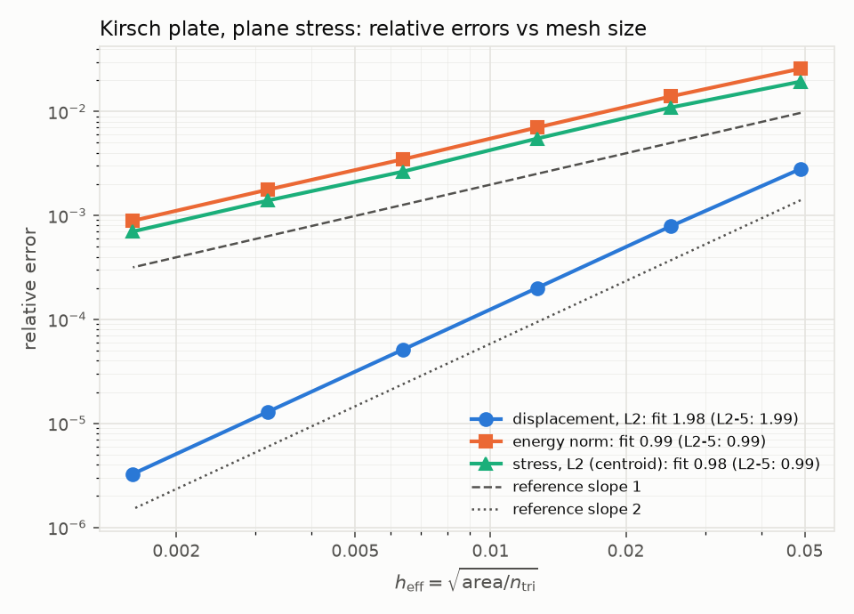
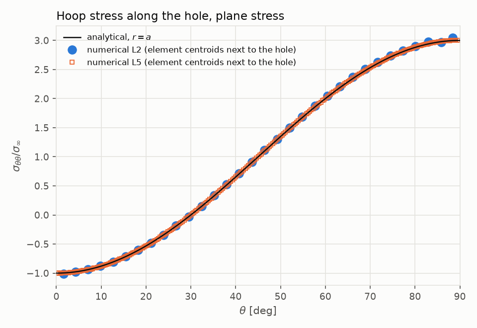
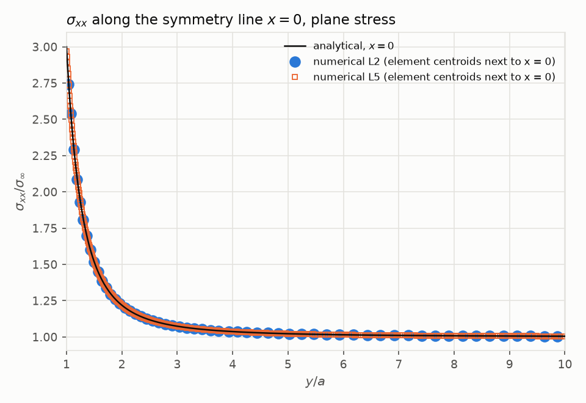
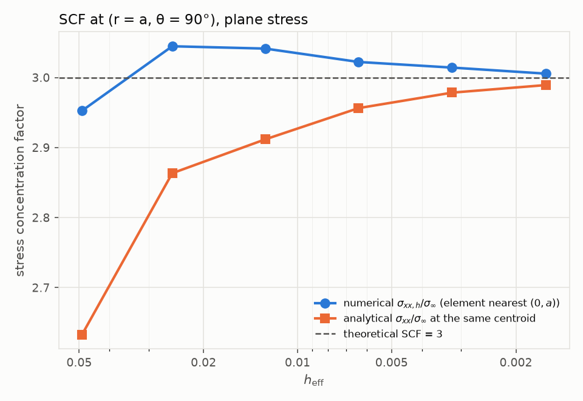
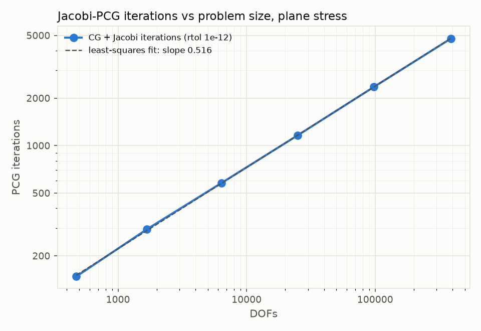

# Verification: Kirsch plate with a hole

This document reports the verification of the CST solver against the Kirsch solution (SPEC section 8). Every number below was produced by `python/run_convergence.py` (raw data: [`verification_results.json`](verification_results.json)); the analytical displacement field was derived and checked symbolically by `python/derive_kirsch_displacement.py`.

## Problem

- Quarter of a square plate of side `L = 1` with a central hole of radius `a = 0.1` (`L/a = 10`), using symmetry.
- Material: `E = 210e9`, `nu = 0.3`, thickness `t = 0.01`; plane stress (figures and tables) and plane strain (tables).
- Uniaxial far-field stress `sigma_inf = 100e6` along x.
- Meshes: `python/mesh_kirsch.py`, levels 0-5, linear triangles, size field graded from the hole; every level halves `h_hole` and `h_far`.

### Boundary conditions

| Group | Condition |
|---|---|
| `left_sym` (x = 0) | `u_x = 0` (symmetry) |
| `bottom_sym` (y = 0) | `u_y = 0` (symmetry) |
| `hole` (r = a) | traction-free |
| `right` (x = L), `top` (y = L) | exact Kirsch traction `t = sigma(x) . n`, evaluated from the analytical field at the 2 Gauss points of each edge |

The Kirsch solution is the solution of an infinite plate. On a finite plate with a uniform traction `sigma_inf` on the outer edges, the computed field would converge to a different (finite-width) solution and the error would stall at the finite-width error. Applying the exact Kirsch traction on `right` and `top` makes the finite quarter plate an exact restriction of the infinite problem, so the continuous solution of the computed problem *is* the Kirsch field and **all errors below are pure discretization error** (plus solver error, shown below to be negligible).

### Analytical displacement field

Derived with sympy from the SPEC stresses through Hooke's law (shear modulus `mu = E / (2 (1 + nu))`, Kolosov constant `kappa = (3 - nu)/(1 + nu)` in plane stress and `3 - 4 nu` in plane strain):

```
u_r     = sigma_inf / (8 mu) [ (kappa - 1) r + 2 a^2 / r + 2 (r + (kappa + 1) a^2 / r - a^4 / r^3) cos 2theta ]
u_theta = -sigma_inf / (4 mu) [ r + (kappa - 1) a^2 / r + a^4 / r^3 ] sin 2theta
```

The script verifies symbolically, for both plane conditions with `E` and `nu` kept symbolic, that the strains of this field reproduce the SPEC `sigma_rr`, `sigma_tt`, `sigma_rt` exactly, that equilibrium holds, that `u_x = 0` on `x = 0` and `u_y = 0` on `y = 0` (the rigid-body constants come out as zero), and that the hole is traction-free. It exits with a non-zero status if any check fails (checked by deliberately corrupting the integration once). The C++ implementation (`kirsch_displacement`) is unit-tested against values printed by the script, for both plane conditions.

## Metrics

All integrals are sums over triangles; in parallel the per-rank sums are reduced with `MPI_Allreduce`.

| Metric | Definition |
|---|---|
| displacement L2 | `sqrt( int |u_h - u|^2 / int |u|^2 )`, `u_h` linear on each triangle, 3-point (degree-2) quadrature |
| energy norm | `sqrt( sum_e int (s_h - s)^T D^-1 (s_h - s) / sum_e int s^T D^-1 s )`, same quadrature, `s = (s_xx, s_yy, t_xy)` |
| stress L2 (centroid) | `sqrt( sum_e A_e |s_h - s(x_c)|^2 / sum_e A_e |s(x_c)|^2 )`, `|s|^2 = s_xx^2 + s_yy^2 + 2 t_xy^2` |
| SCF | `s_xx,h / sigma_inf` in the element whose centroid is closest to `(0, a)`, next to the analytical `s_xx / sigma_inf` at the same centroid; theoretical value 3. No extrapolation. |

Mesh size: `h_max` is the longest edge; `h_eff = sqrt(total area / number of triangles)`. Rates are least-squares slopes of `log(error)` vs `log(h_eff)`.

Runs: 8 MPI ranks, distributed path, METIS partitioning, Jacobi-PCG with `rtol = 1e-12`.

## Results

### Meshes

| Level | DOFs | h_max | h_eff |
|---|---|---|---|
| 0 | 474 | 1.2014e-01 | 4.8955e-02 |
| 1 | 1,680 | 6.5470e-02 | 2.5187e-02 |
| 2 | 6,394 | 3.2846e-02 | 1.2685e-02 |
| 3 | 24,852 | 1.6769e-02 | 6.3765e-03 |
| 4 | 97,760 | 8.6021e-03 | 3.2005e-03 |
| 5 | 389,072 | 4.4018e-03 | 1.6006e-03 |

### Plane stress

| Level | PCG iterations | true rel. residual | displacement L2 | energy norm | stress L2 (centroid) | SCF numerical | SCF analytical at same centroid |
|---|---|---|---|---|---|---|---|
| 0 | 148 | 7.07e-13 | 2.8051e-03 | 2.5830e-02 | 1.9399e-02 | 2.9526 | 2.6330 |
| 1 | 295 | 9.49e-13 | 7.8911e-04 | 1.3973e-02 | 1.0937e-02 | 3.0446 | 2.8633 |
| 2 | 580 | 1.09e-12 | 2.0066e-04 | 7.0107e-03 | 5.4899e-03 | 3.0413 | 2.9117 |
| 3 | 1159 | 2.36e-12 | 5.1123e-05 | 3.4680e-03 | 2.6409e-03 | 3.0222 | 2.9563 |
| 4 | 2355 | 8.68e-12 | 1.2975e-05 | 1.7742e-03 | 1.3942e-03 | 3.0141 | 2.9784 |
| 5 | 4777 | 3.45e-11 | 3.2682e-06 | 8.9005e-04 | 7.0165e-04 | 3.0055 | 2.9892 |

### Plane strain

| Level | PCG iterations | true rel. residual | displacement L2 | energy norm | stress L2 (centroid) | SCF numerical | SCF analytical at same centroid |
|---|---|---|---|---|---|---|---|
| 0 | 157 | 8.07e-13 | 2.8116e-03 | 2.6689e-02 | 2.2130e-02 | 3.0258 | 2.6330 |
| 1 | 313 | 9.73e-13 | 8.0035e-04 | 1.4592e-02 | 1.2852e-02 | 3.0910 | 2.8633 |
| 2 | 626 | 1.15e-12 | 2.0354e-04 | 7.3160e-03 | 6.4558e-03 | 3.0707 | 2.9117 |
| 3 | 1236 | 2.73e-12 | 5.1808e-05 | 3.5950e-03 | 3.0635e-03 | 3.0384 | 2.9563 |
| 4 | 2514 | 1.03e-11 | 1.3223e-05 | 1.8543e-03 | 1.6469e-03 | 3.0223 | 2.9784 |
| 5 | 5124 | 4.18e-11 | 3.3380e-06 | 9.3127e-04 | 8.3119e-04 | 3.0093 | 2.9892 |

### Fitted rates (slope of log error vs log h_eff)

| Quantity | Expected | Plane stress: fit L0-5 | fit L2-5 | Plane strain: fit L0-5 | fit L2-5 |
|---|---|---|---|---|---|
| displacement L2 | 2.0 | 1.980 | 1.989 | 1.975 | 1.985 |
| energy norm | 1.0 | 0.990 | 0.995 | 0.987 | 0.992 |
| stress L2 (centroid) | 1.0 | 0.980 | 0.987 | 0.973 | 0.981 |
| PCG iterations vs DOFs | 0.5 | 0.516 | 0.514 | 0.517 | 0.512 |

### Consecutive-level rates

| Quantity | Plane | L0→1 | L1→2 | L2→3 | L3→4 | L4→5 |
|---|---|---|---|---|---|---|
| displacement L2 | plane stress | 1.908 | 1.996 | 1.988 | 1.989 | 1.990 |
| displacement L2 | plane strain | 1.891 | 1.996 | 1.989 | 1.981 | 1.987 |
| energy norm | plane stress | 0.925 | 1.005 | 1.023 | 0.972 | 0.996 |
| energy norm | plane strain | 0.908 | 1.007 | 1.033 | 0.960 | 0.994 |
| stress L2 (centroid) | plane stress | 0.862 | 1.005 | 1.064 | 0.927 | 0.991 |
| stress L2 (centroid) | plane strain | 0.818 | 1.004 | 1.084 | 0.900 | 0.987 |


Expected rates for linear triangles: displacement L2 `O(h^2)`, energy norm and stress L2 `O(h)`. For CG with a Jacobi preconditioner the condition number grows like `h^-2`, so the iteration count grows like `h^-1`, i.e. like `DOFs^0.5` in 2D.

## Figures

**Errors vs mesh size** (plane stress), with the fitted slopes and reference slopes 1 and 2:



**Hoop stress along the hole**: numerical values at the centroids of the elements next to the hole (levels 2 and 5) and the analytical `sigma_tt(r = a) / sigma_inf = 1 - 2 cos 2theta`. The numerical points lie at the centroids, slightly outside `r = a`; they approach the curve as the mesh is refined:



**`sigma_xx` along the symmetry line `x = 0`** (levels 2 and 5) vs the analytical `sigma_xx(0, y)`:



**Stress concentration factor** vs `h_eff`:



**Jacobi-PCG iterations** vs DOFs:



## Discussion

- **Rates match the theory.** Over levels 2-5 the fitted rates are 1.989 / 1.985 (displacement L2, plane stress / strain), 0.995 / 0.992 (energy norm) and 0.987 / 0.981 (stress L2), against 2, 1 and 1. The fits over all levels are slightly lower (1.980, 0.990, 0.980 in plane stress) because level 0 is pre-asymptotic: it has only 8 edges on the hole, and its consecutive rates (L0→1: 1.908, 0.925, 0.862) are the lowest of all.
- **The centroid stress error oscillates around rate 1** (plane stress L2→3: 1.064, L3→4: 0.927). The meshes are not nested (each level is a new unstructured Delaunay mesh), and sampling the stress at one point per element is sensitive to the element shapes next to the hole; the energy norm, which integrates over each element, oscillates less (1.023, 0.972).
- **SCF.** The numerical value is below 3 on the coarsest mesh (2.9526 at L0), overshoots from L1 on (3.0446 at L1) and then approaches 3 from above (3.0055 at L5). The analytical value at the same centroid approaches 3 from below (2.9892 at L5), because the centroid lies at `r > a` where the exact stress is lower. The gap between them shrinks from 0.32 (L0) to 0.016 (L5).
- **PCG iterations** grow like `DOFs^0.516` (plane stress, all levels), close to the expected 0.5.
- **Solver tolerance.** With `rtol = 1e-12`, the true relative residual `||b - Ax|| / ||b||` exceeds `rtol` from level 2 on and exceeds `10 rtol` at level 5 (3.45e-11 in plane stress, 4.18e-11 in plane strain) and, in plane strain, already at level 4 (1.03e-11); the solver prints its warning in these cases. This is the attainable-accuracy limit of CG in double precision on these matrices, not a bug. Its effect on the reported errors is negligible: re-running level 5 (plane stress) with `rtol = 1e-10` changes the displacement L2 error by 1.3e-7 (relative), the energy-norm error by 6.6e-12 and the stress L2 error by 3.1e-11, so the tables show discretization error only.
- **Plane strain** gives the same rates; its errors are slightly larger than in plane stress at every level.

## Reproducing

```
python/.venv/bin/pip install -r python/requirements.txt -r python/requirements-dev.txt
python/.venv/bin/python python/derive_kirsch_displacement.py
for l in 0 1 2 3 4 5; do python/.venv/bin/python python/mesh_kirsch.py --level $l -o meshes/kirsch_L$l.msh; done
python/.venv/bin/python python/run_convergence.py --np 8
```

Outputs of the runs go to `results/convergence/` (not committed); the figures and `verification_results.json` are regenerated in `docs/`.
